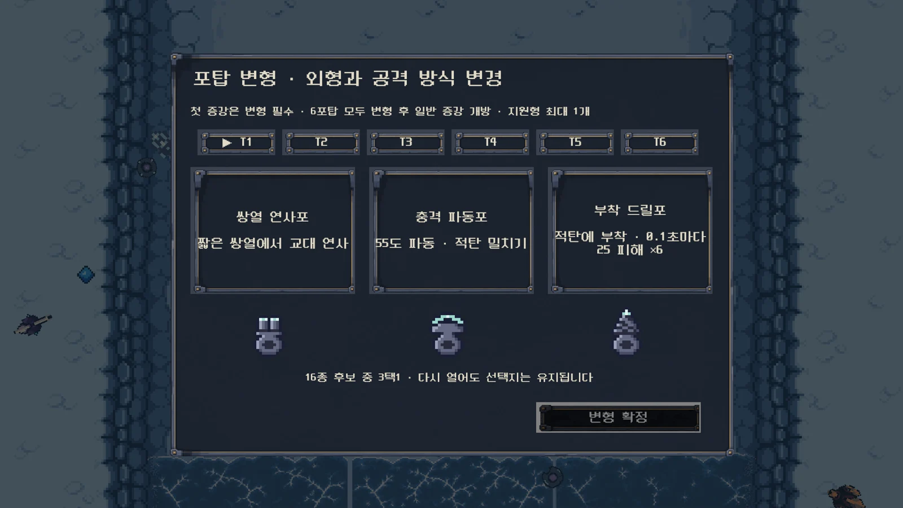
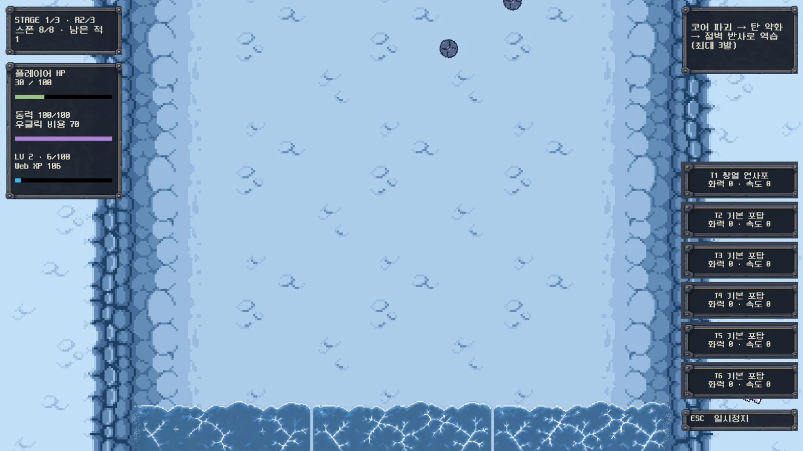
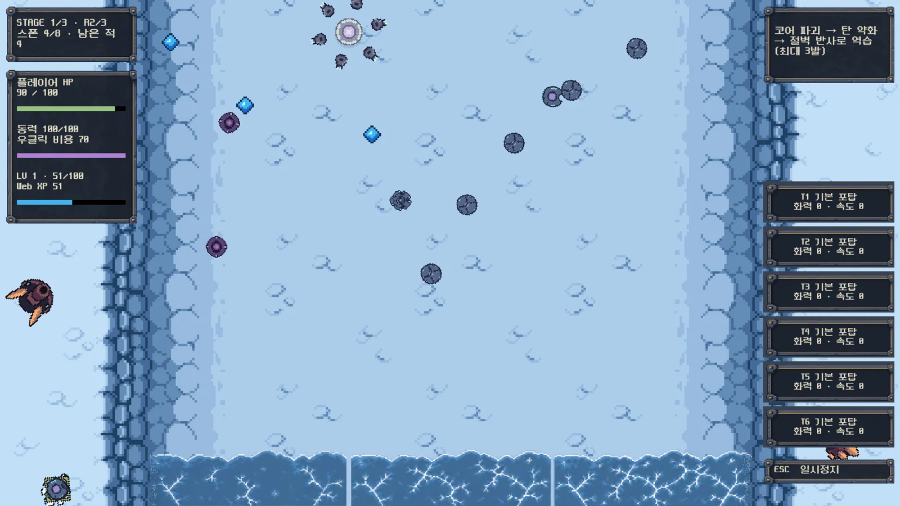

# Rushitadel

**이동·직접 공격과 포탑 성장을 조합해 적의 공격을 버티는 액션 디펜스 게임입니다.**

3인 팀 · 개발 완료 · 액션 디펜스 · Unity 6000.5.3f1 · C#

[Windows 실행 파일](https://github.com/lde0707/portfolio-game-builds/releases/tag/rushitadel-2026-11-14-r2) · [QA 엑셀](https://leedoeon.vercel.app/qa/reports/rushitadel.xlsx) · [QA 포트폴리오](https://leedoeon.vercel.app/qa/index.html)

## 내가 맡은 역할

포탑 성장·전투·재화 시스템 기획을 담당했습니다.

## 게임의 주요 흐름

저장 불러오기 → 전투·경험치 → 다음 라운드 → 포탑 변형

## 실행 방법

### Unity 없이 플레이

1. 위 **Windows 실행 파일** 링크에서 `Rushitadel-Windows-x64.zip`을 받습니다.
2. ZIP **전체를 압축 해제**합니다.
3. `Rushitadel.exe`를 실행합니다.

Windows 64비트용입니다. EXE와 `Data` 폴더·`UnityPlayer.dll`을 함께 유지하세요. GitHub의 `Source code` 압축 파일은 게임 실행 패키지가 아닙니다.

**기본 조작:** WASD 이동 / 마우스 조준 / 좌클릭 원거리 공격 / 우클릭 동력 공격 / Esc 일시정지

Unity에서 소스 열기

1. Unity Hub에서 `Rushitadel2D` 폴더를 프로젝트로 추가합니다.
2. **Unity 6000.5.3f1**으로 엽니다.
3. `Assets/Scenes/Title.unity` 씬을 열고 Play를 실행합니다.
4. 실행 파일을 만들 때 Windows Build Support를 설치하고 기존 Build Settings의 씬 구성으로 Windows x64를 빌드합니다.

## QA 테스트

Windows 빌드에 실제 키보드·마우스 입력을 보내 확인한 내용입니다. 세부 조건과 관찰값은 **QA 엑셀의 플레이 재검증 시트**에서 볼 수 있습니다.

| 확인 기능 | 테스트 조건 | 관찰 결과 |
|---|---|---|
| 전투·성장 | 이동·공격 후 경험치 획득 | 다음 라운드 진입과 포탑 변형 적용 |
| 상단 이동 제한 | W를 길게 유지 | 수정 전 이탈 재현, 수정 후 본체까지 화면 안 유지 |
| 반동·일시정지 | 상단 반동 발사 후 일시정지 | 반동 후 경계 유지, 정지 중 카메라·체력 유지 |

### 결함 수정 후 재검증

W를 길게 누르면 캐릭터가 화면 위로 사라지는 문제를 확인했습니다. 본체 반지름을 포함한 경계 제한을 적용한 뒤, 같은 이동 입력과 반동 발사로 화면 안에 유지되는지 재검증했습니다.

| 수정 전 | 수정 후 |
|---|---|
|  |  |

**검증 범위:** 모든 테마·보스 완주와 이전 버전 전체 저장 파일 호환성은 확인하지 않았습니다.

[실제 입력 검증 기록](PLAYTEST.md) · [실행·검증 안내](PLAY.md)

## 소스와 상세 문서

- [이동 경계·전방 압박](Rushitadel2D/Assets/Scripts/World/ForwardPressureController.cs)
- [전투 진행](Rushitadel2D/Assets/Scripts/Progression/CampaignDirector.cs)
- [기존 개발·설계 기록](README-DEV-NOTES.md)
