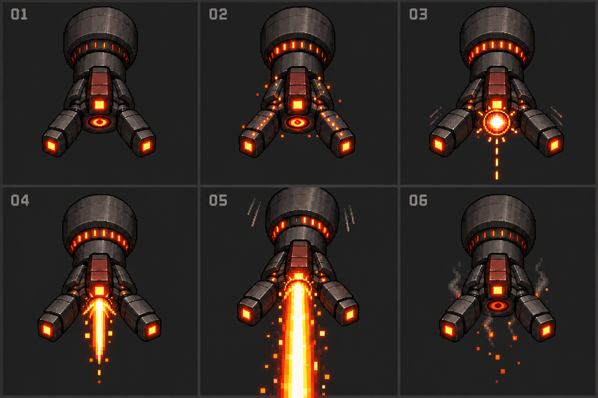

# 용암 보스 — 손 레이저와 파괴형 탄막

상태: 설계 초안, 게임 코드 미적용. 보스 상체와 독립 손 2기. 손가락 3개, 손바닥 중앙 원형 코어가 레이저 원점이다.

## 공격 이미지

|탄|역할|기본 포탑탄 명중 기준 초안|
|---|---|---|
|[불씨탄](../../output/imagegen/lava-boss-projectiles-20261007/01-ember-orb.png)|나선·부채꼴 기본탄|1회|
|[용재 침탄](../../output/imagegen/lava-boss-projectiles-20261007/02-slag-dart.png)|발사 순간 위치 조준 후 직진|1회|
|[현무암 중탄](../../output/imagegen/lava-boss-projectiles-20261007/03-armored-magma.png)|느리고 단단함, 1회 도탄|5회|
|[삼열 분열탄](../../output/imagegen/lava-boss-projectiles-20261007/04-cluster-bomb.png)|점멸 후 침탄 3개로 분열|3회|
|[작열 회전날](../../output/imagegen/lava-boss-projectiles-20261007/05-heat-crescent.png)|넓은 곡선 공간 차단|3회|
|[용광로 기뢰](../../output/imagegen/lava-boss-projectiles-20261007/06-furnace-mine.png)|충전 후 불씨 방사, 소멸|4회|
|[손바닥 레이저](../../output/imagegen/lava-boss-projectiles-20261007/07-palm-laser.png)|예고 후 지속 광선|광선 직접 파괴 없음|

분열탄·기뢰를 미리 파괴하면 후속 탄은 생기지 않는다. D=플레이어 충돌 지름.

## 패턴

### 1. 쌍나선 용광로
양 손목에서 불씨 7발씩, 0.35초 간격 6회. 좌우 반대 방향으로 매회 8도 회전. 손바닥 조준 침탄은 0.8초 간격. 큰 횡이동으로 조준탄을 유도하고 나선 탄을 부숴 통과한다.

### 2. 절벽 반사 협공
현무암 중탄을 좌우 절벽 방향으로 각각 3개. 길 안에서 한 번 도탄 후 중앙으로 복귀. 0.7초 뒤 중앙에 느린 불씨 부채탄. 반사 지점 경고 표시. 중탄 하나의 우선 파괴가 탈출 공간을 만든다.

### 3. 분열하는 탄벽
분열탄 5개를 가로 배치. 1.2초 이동, 0.5초 균열 점멸, 진행각 -25/0/+25도로 분열. 다음 줄은 어긋난 배치. 플레이어에서 최소 2D 떨어진 곳에서 분열하도록 제한. 먼저 부수면 후속 세 발도 제거된다.

### 4. 손 레이저 가위질
왼손이 바깥→중앙 방향으로 먼저 회전 사격, 오른손은 0.7초 늦게 발사. 먼저 쏜 광선이 꺼진 뒤 다른 광선이 중앙을 통과하도록 스윕 범위를 제한한다. 기뢰는 최대 2개. 중앙 동시 폐쇄 금지.

### 5. 용광로 압착
기뢰 3개 → 한 손 충전과 반대편 회전날 2개 → 파괴한 공간으로 이동 → 레이저 종료 후 좌우 교대 → 과열로 2초 공격 정지.

## 충전·발사 타임라인

|시간|연출·판정|
|---|---|
|0~0.25초|손이 뒤로 살짝 물러나고 손가락을 벌려 고정|
|0.25~0.9초|손목 슬롯 순차 점등, 입자가 손바닥으로 모임|
|0.9~1.25초|구체 압축, 경고선과 조준 고정|
|1.25~1.35초|시험 광선, 피해 없음|
|1.35~1.5초|선두가 전진하며 굵기 증가, 활성 본 광선에만 피해|
|1.5~2.8초|본 발사, 미세 반동·발사구 파동|
|2.8~3.2초|공급 차단·잔광 소멸, 잔열·연기에는 피해 없음|

손바닥 소켓에 시작점을 부착한다. 발사구/몸통/끝부분 분리. 중심 광선만 충돌, 주변 빛·불꽃 제외. 레이저는 절벽에서 종료하고 도탄하지 않는다. 종료 판정과 잔광은 분리한다.

## 단계와 밸런스

HP 100~65%는 1~3번 개별 사용, 65~30%는 4번과 일반 탄막 1종까지 조합, 30% 이하는 5번. 예고 시간은 줄이지 않는다. 안전 간격 최소 1.4D, 3유닛 사거리에서 파괴 기회 보장. 후방 위험과 동시 퇴로 폐쇄 금지. 실제 생존 경로·공격 소요 시간은 미검증이다.

