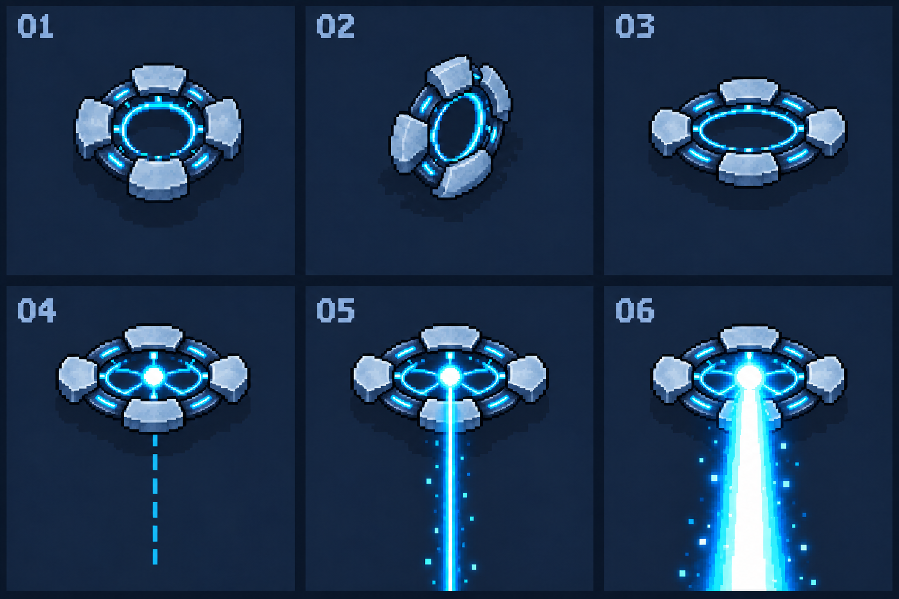

# 얼음 고리 보스 — 왕복·레이저·도탄

상태: 설계 초안. 좌우 고리 2기만 사용, 중앙 추가 고리 없음. 얇고 빈 고리로 읽혀야 하며 두꺼운 원통이 되어서는 안 된다.

## 공격 이미지와 규칙

|이미지|역할·내구도 초안|
|---|---|
|[대형 고리](../../output/imagegen/ice-ring-boss-20261007/01-ring-boomerang.png)|보스 부위, 큰 곡선 왕복. 기본탄 8회 상당 집중 피해 시 일시 무력화|
|[초승달 부메랑](../../output/imagegen/ice-ring-boss-20261007/02-crescent-boomerang.png)|3회 명중 파괴, 도탄 없음|
|[도탄 에너지볼](../../output/imagegen/ice-ring-boss-20261007/03-ricochet-orb.png)|2회 명중 파괴, 도탄 2회 또는 수명 6초|
|[중장갑 결정탄](../../output/imagegen/ice-ring-boss-20261007/04-heavy-prism.png)|5회 명중 파괴, 도탄 최대 1회|
|[서리 침탄](../../output/imagegen/ice-ring-boss-20261007/05-frost-dart.png)|1회 명중 파괴, 도탄 없음|
|[관통 레이저](../../output/imagegen/ice-ring-boss-20261007/06-ring-laser.png)|광선 파괴 불가, 발사 고리 무력화 시 중단|

## 고리 상태

대기 → 경로 예고 → 출격 → 감속 → 기립 → 레이저 → 눕기 → 복귀.

출격 전 플레이어 위치를 한 번 기록하고 이후 추적하지 않는다. 복귀는 정해진 곡선, 0.6초 전 방향 화살표 표시. 레이저 중 위치 고정, 회전 사격만 허용. 빈 중앙은 접촉 판정 없음. 무력화 시 접촉·광선 판정 제거, 2초 비활성 뒤 보스 옆에서 재충전. 보스 부위 HP·무력화 누적 방식은 후속 확정 필요.

## 패턴

1. **엇갈리는 왕복 고리:** 왼고리 출격, 0.65초 뒤 오른고리 반대 곡선. 끝에서 0.35초 감속 후 외측 복귀. 본체는 침탄 5발 부채꼴 2회. 먼저 복귀한 고리 뒤로 통과.
2. **부메랑 포대:** 한 고리가 측면에 정지·기립, 1.2초 충전 뒤 1.6초 레이저. 반대 고리는 소형 부메랑 3개를 0.3초 간격. 다음 공격 좌우 교대.
3. **반사 회랑:** 상단 두 고리가 평행 고정 레이저. 광선 사이 최소 2.2D. 본체 에너지볼 4개가 벽 반사 후 진입. 포탑 요격으로 통로 유지.
4. **레이저 릴레이:** 왼고리 외측→중앙 스윕. 종료 0.45초 후 오른고리 발사. 본체는 소형 부메랑 한 쌍씩. 동시 중앙 폐쇄 금지.
5. **빙환 봉쇄:** 두 고리 순차 출격 → 한쪽 측면 레이저 → 반대쪽 복귀·부메랑 2개 → 본체 결정탄 2개 → 좌우 교대 → 복귀 후 2.5초 휴식.

D=플레이어 충돌 지름.

## 기립·충전 연출

|구간 길이|연출|
|---|---|
|0.35초|회전 감속, 얇은 고리 세워짐|
|0.45초|내주 네 방향에서 중앙으로 빛 집결|
|0.40초|중앙 핵 압축, 조준 고정|
|0.10초|무피해 시험 광선|
|1.60초|본 발사, 선두 전진·굵기 증가·미세 반동|
|0.35초|광선 소멸 후 다시 눕기|

발사 방향이 하단이면 탑뷰 원근상 구멍이 가로로 긴 타원으로 읽혀야 한다. 컨셉 시트는 자세·충전 참고용이며 실제 프레임 간 보간과 피벗 정렬은 별도 작업이다.

## 난도 제한

HP 100~70% 패턴1·2, 70~35% 패턴3·4 추가, 35% 이하 패턴5.
대형 고리 2개, 소형 부메랑 4개, 도탄볼 8개 상한. 레이저 2개 활성 중 대형 고리 돌진 금지. 안전 간격 최소1.5D. 광선이 플레이어 위치를 훑는 선속도는 플레이어 속도60% 이하부터 시험한다. 도탄 가속 없음. 밖→안 통과/안→밖 반사. 광선 도탄 없음. 후방 위험과 퇴로 폐쇄 금지. 피격 보호 시간을 공유해 광선 프레임 중첩 피해를 막는다.

