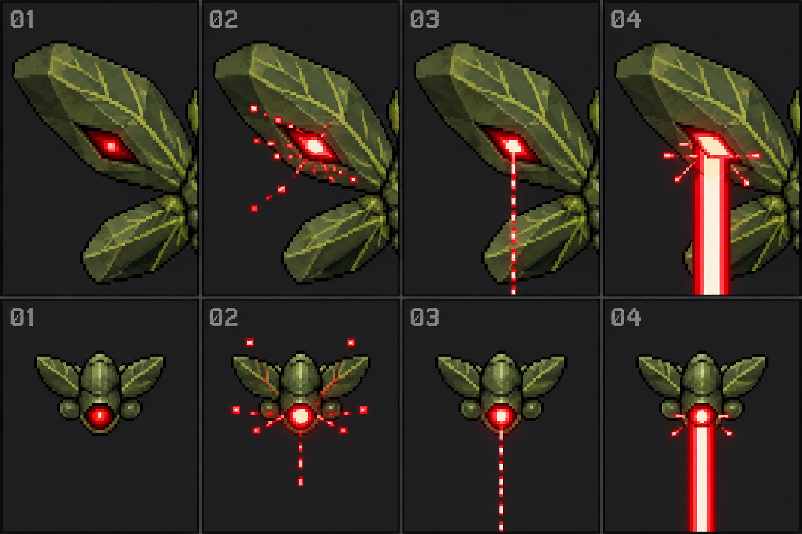

# 풀 나비 보스 — 개화 탄막과 드론 레이저

상태: 설계·아트 초안. 큰 날개2개·작은 날개2개와 좌우 소형 드론4기. 공격은 기존 빨간 부위에서 발생한다. 포신을 추가하지 않는다.

## 탄 5종

|이미지|동작|기본탄 명중 기준 내구도 초안|
|---|---|---|
|[꽃가루 구슬](../../output/imagegen/butterfly-boss-20261007/01-pollen-pearl.png)|나선·부채꼴 기본탄|1회|
|[붉은 가시](../../output/imagegen/butterfly-boss-20261007/02-thorn-needle.png)|발사 순간 위치 조준, 이후 직진|1회|
|[꽃잎 칼날](../../output/imagegen/butterfly-boss-20261007/03-petal-blade.png)|좌우 곡선, 진행 방향으로 회전|3회|
|[분열 씨앗](../../output/imagegen/butterfly-boss-20261007/04-seed-pod.png)|점멸 후 가시3개로 분열|4회|
|[날개 비늘](../../output/imagegen/butterfly-boss-20261007/05-scale-kite.png)|엇갈린 줄로 내려오는 넓은 마름모|2회|

씨앗을 먼저 파괴하면 후속탄 없음. 초록 배경과 구별되는 적색·주황·크림 중심과 짙은 외곽선.

## 발사구 계약

- 큰 날개 빨간 부분2곳: 넓은 꽃잎 탄막과 회전 레이저.
- 작은 날개 빨간 부분2곳: 가시·비늘탄과 짧은 고정 레이저.
- 본체 중앙 빨간 원: 씨앗과 굵은 직선 레이저.
- 드론4기의 빨간 원: 가는 조준 레이저, 두 기씩 교대.
- 같은 발사구에서 탄과 레이저 동시 생성 금지.

## 패턴

### 1. 개화 나선
큰 날개에서 구슬 각5발, 0.4초 간격6회. 좌우 발사각을 반대 방향으로 매회7도 회전. 작은 날개는 가시3발 부채꼴을0.9초 간격. 조준탄을 한쪽에 유도한 뒤 구슬을 부숴 반대쪽 틈으로 이동.

### 2. 나비 레이저 릴레이
왼위·오른아래 드론1초 충전 후0.9초 발사. 종료0.35초 뒤 나머지 두 기 발사. 보스는 교대 사이에만 꽃잎 한 쌍. 드론은 충전 전에 위치 선정하고 발사 중 정지. 네 기 동시 발사 없음.

### 3. 날개 가위질
큰 날개 레이저가 바깥에서 중앙으로 천천히 회전. 통로2D에서 정지·종료. 본체 씨앗2개가 통로 진입. 이 패턴에서 드론 레이저는 쉬게 한다. 씨앗을 분열 전에 요격.

### 4. 비늘 장막
비늘7개 가로줄을3회. 각 줄에 통과 가능한 빈틈을 두되 좌우로 조금씩 이동. 드론1기가 빈틈 바깥쪽 레이저. 다음 줄 도착 전 이동 가능한 거리로 틈 변위를 제한. 직접 탄을 부수면 더 짧은 경로 개방.

### 5. 붉은 정원
드론2기 고정 레이저로3구역 → 낮은 밀도 개화 나선 → 드론 광선 종료 후 중앙 굵은 레이저 충전 → 중앙 조준 고정 후 다음 드론 예고 → 중앙 광선 종료 후 드론 발사 → 순환 끝2.5초 휴식.
중앙 대형 광선과 드론 광선은 교대한다. 다음 안전 구역을 읽고 이동하는 패턴.

D=플레이어 충돌 지름. 정확한 탄속·사이클 길이는 실제 이동속도·맵 폭에 맞춰 튜닝한다.

## 레이저 리소스

- [보스용](../../output/imagegen/butterfly-boss-20261007/06-boss-laser.png)
- [드론용](../../output/imagegen/butterfly-boss-20261007/07-drone-laser.png)

|시간|연출|
|---|---|
|0~0.25초|날개가 살짝 뒤로 젖혀지고 빨간 발사구 점등|
|0.25~0.75초|입자가 안으로 모임, 녹색 장갑은 매트 유지|
|0.75~1.15초|밝은 핵 압축, 점선 경고·조준 고정|
|1.15~1.25초|무피해 시험 광선|
|1.25초 이후|본 광선 선두 전진·굵기 증가, 미세 반동|
|종료 마지막0.25초|피해 판정 종료 후 잔광 소멸|

드론의 전체 준비는 조금 줄여도 조준 고정0.4초는 유지. 보스 폭0.55D, 드론0.25D부터 시험. 발사구 섬광/몸통/끝부분 분리. 광선 원점은 빨간 소켓에 부착. 주변 빛·불꽃 무판정, 레이저는 절벽에서 종료·도탄 없음. 충전음→압축음→발사음, 드론은 가벼운 음색. 그림은 컨셉으로 타이밍이 담긴 완성 애니메이션이 아니다.

## 페이즈·안전 규칙

HP100~70% 개화·릴레이, 70~35% 가위·장막 추가, 35% 이하 붉은 정원. 후반에도 예고 시간 축소 금지.

드론 충전 중 기본탄6회 상당 피해로 이번 광선 취소·3초 비활성 제안. 3유닛 포탑 사거리에서 실제 공격 기회와 최저 화력 대응을 검증해야 한다. 드론 사망·재생성·보상은 미정.

고밀도 탄막 중 드론 광선 최대2개. 안전통로1.5D 이상이며 현재 위치에서 도달 가능해야 한다. 씨앗은0.5초 점멸 후 분열, 플레이어 바로 옆 분열 금지. 후방 위험과 모든 탈출로 동시 차단 금지.

## 참고 자료와 적용

- [Sparen: 방향성 탄·고정각·조준각](https://sparen.github.io/ph3tutorials/ddsga2.html): 방향을 읽을 수 있는 실루엣과 발사각 조합을 참고.
- [Luna Abyss 개발자 인터뷰](https://www.unrealengine.com/developer-interviews/how-unreal-engine-empowered-a-small-team-to-build-luna-abyss-beautiful-bullet-hell-prison): 충분한 예고, 명확한 회피 방법, 판정에 맞는 간격 원칙 참고.

자료의 수치를 복사한 것이 아니라 본 게임에 맞춰 제안한 패턴이며 최종 난도 검증은 남아 있다.

